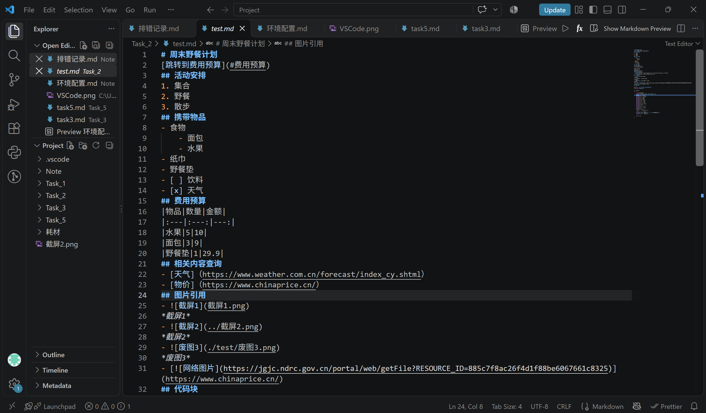

# AI-Lab通识学习计划与环境踩坑记录
## Markdown
1. 任务列表使用英文半角[]
2. 本地图片插入考虑同级，上一级，下一级文件位置
3. 运行代码选择Terminal
## Linux基础
1. printf后加空格，英文单引号
2. 将文件复制到上一级另一文件夹，注意当前所在位置，写法不同  
3. 复制多个文件到上一级另一文件夹均需标注此级文件夹  
4. 查找find空格（find 位置 -依据）
5. 删除空目录rmdir  
   向上递归rmdir -p 一条线 
   删除目录rm -r  
6. 查找^apple用\转义
## Git
|类型|错误|解决|
|---|---|---|
|执行目录|在仓库外执行命令，提示不是 Git 仓库| 进入包含 `.git` 的项目目录|
|文件保存|未保存就执行 add、commit，|按 Ctrl+S 保存，再暂存和提交|
|历史查看|git log界面直接输入命令|按 q 退出|
## 一段代码块
``` c
#define _CRT_SECURE_NO_WARNINGS
#include <stdio.h>

int main()
{
	char name[20];
	printf("please input your name:\n");
	scanf("%s",name);
	printf("%s", name); 
	printf("%c",53);
	printf("%c",50);
	printf("%c",48);
	printf("%c", 49);
	printf("%c", 51);
	printf("%c", 49);
	printf("%c\n", 52); 
	printf("??");
	printf("%c",'\'');
	printf("%c", 39);
    printf("%c", '"');
	printf("\"\n");
	//这是一行，普通的注释
}
```
## 环境截图

## 外部参考链接
[Markdown](https://markdown.com.cn/basic-syntax)