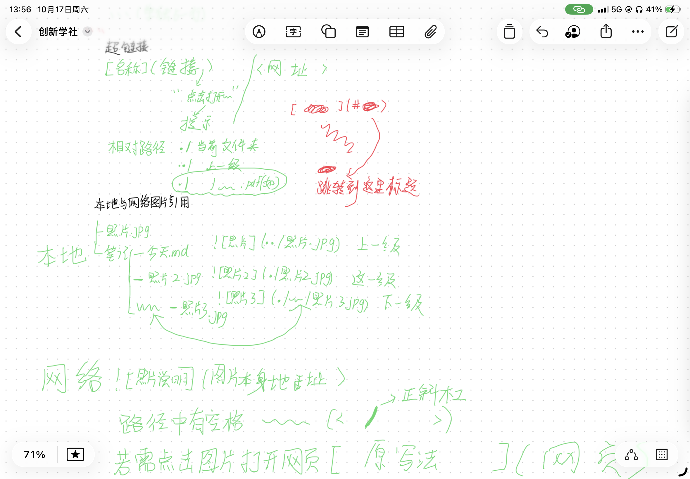

# 周末野餐计划
[跳转到费用预算](#费用预算)
## 活动安排
1. 集合
2. 野餐
3. 散步
## 携带物品
- 食物
    - 面包
    - 水果
- 纸巾
- 野餐垫
- [ ] 饮料
- [x] 天气
## 费用预算
|物品|数量|金额|
|:---|:---:|---:|
|水果|5|10|
|面包|3|9|
|野餐垫|1|29.9|
## 相关内容查询
- [天气]（https://www.weather.com.cn/forecast/index_cy.shtml）
- [物价]（https://www.chinaprice.cn/）
## 图片引用
-   
*截屏1*  
-   
*截屏2*  
-   
*废图3*  
- [](https://www.chinaprice.cn/)
## 代码块
```c
#define _CRT_SECURE_NO_WARNINGS
#include <stdio.h>

int main()
{
	char name[20];
	printf("please input your name:\n");
	scanf("%s",name);
	printf("%s", name); 
	printf("%c",53);
	printf("%c",50);
	printf("%c",48);
	printf("%c", 49);
	printf("%c", 51);
	printf("%c", 49);
	printf("%c\n", 52); 
	printf("??");
	printf("%c",'\'');
	printf("%c", 39);
    printf("%c", '"');
	printf("\"\n");
	//这是一行，普通的注释
	/*这也是一行注释*/
	printf("好人一生平安，一些老式爱心表情包");
    printf("%s","\\test");
	
	return 0;
}
```


