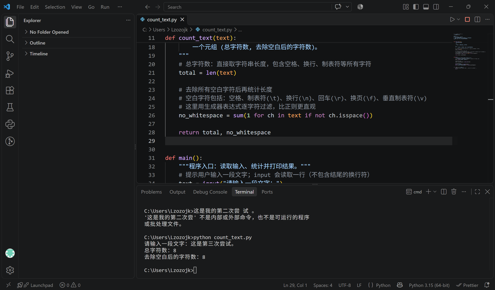
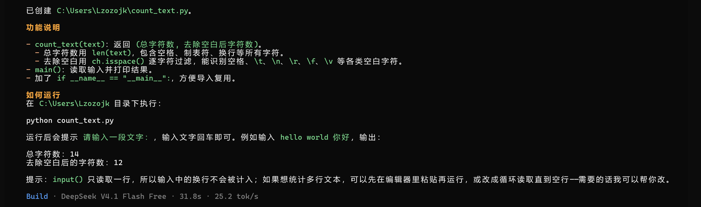
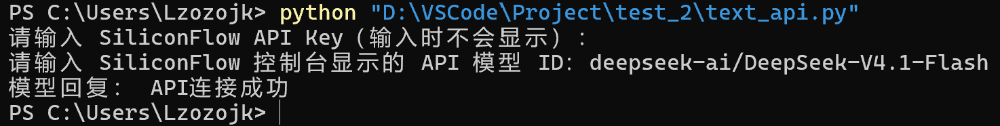

# Task01：现代AI编程环境配置

## 环境配置  
- 现代 AI IDE / 智能工作台：VSCode+AI插件+Python3.15
- 终端AI Agent：OpenCode
- 大模型服务/API：Silicon Flow
## 配置步骤
1. Python3.15
2. VSCode+AI插件
3. 下载node.js，在终端安装OpenCode
4. 使用CCSwitch自动接入SiliconFlow的AI模型
5. 在终端交互生成test.py文件
## 截图
  
*VSCode工作界面*  
  
*OpenCode在终端成功交互*  
  
*跑通大模型API调用问答*